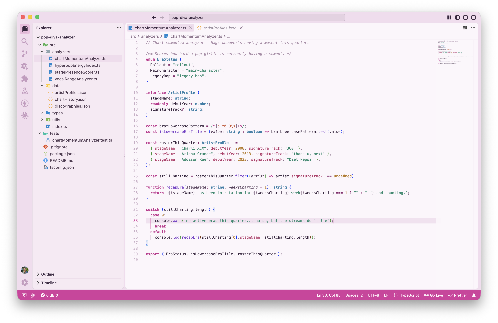
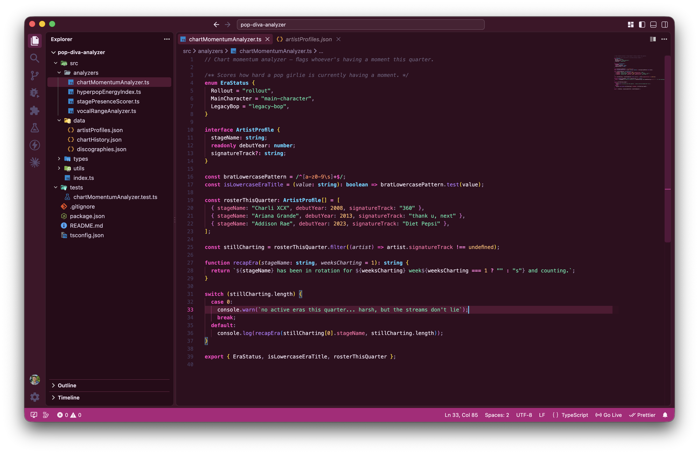
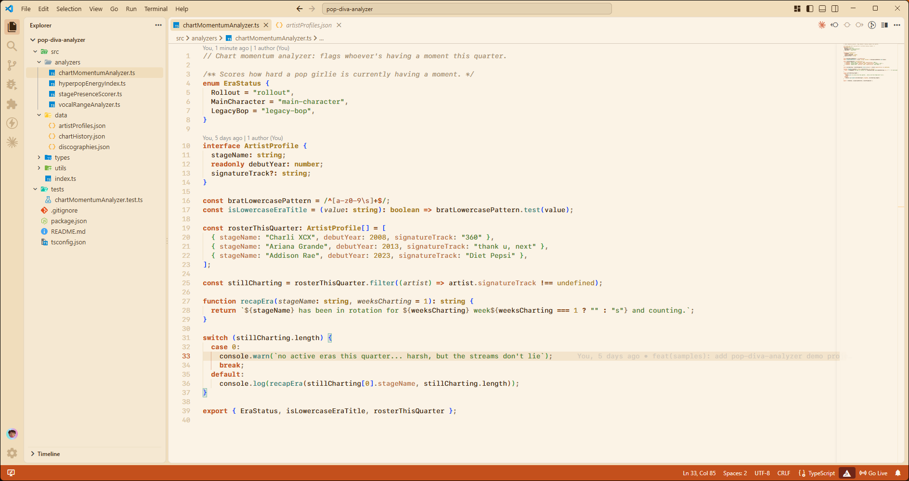
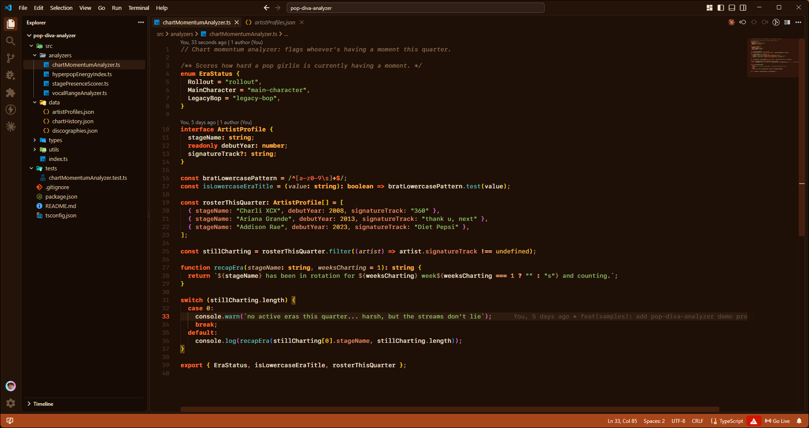

# KSHN Themes

A family of VS Code color themes, each pairing a soft pastel light mode with a saturated dark mode
built from the same accent.

## Install

Search for **KSHN Themes** in the Extensions view (`Cmd+Shift+X`), or run:

```
ext install kshncodes.kshn-themes
```

## Themes

### KSHN Pink Moscato



### KSHN Dark Pink Moscato



### KSHN Champagne



### KSHN Dark Champagne



## License

MIT
